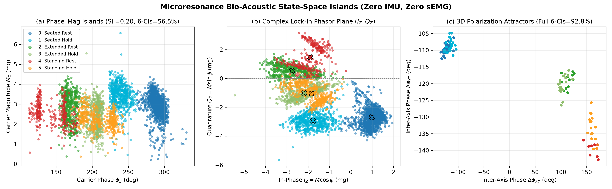
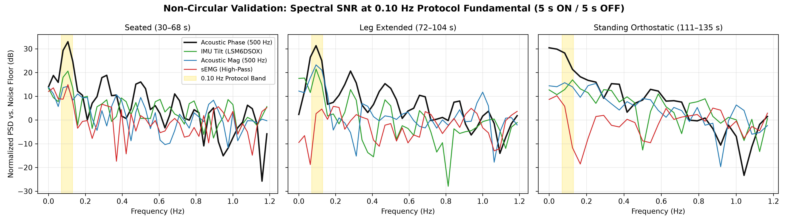
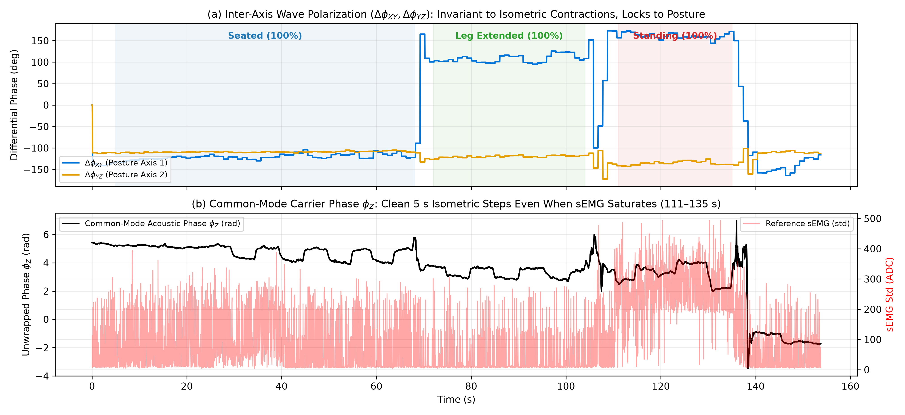
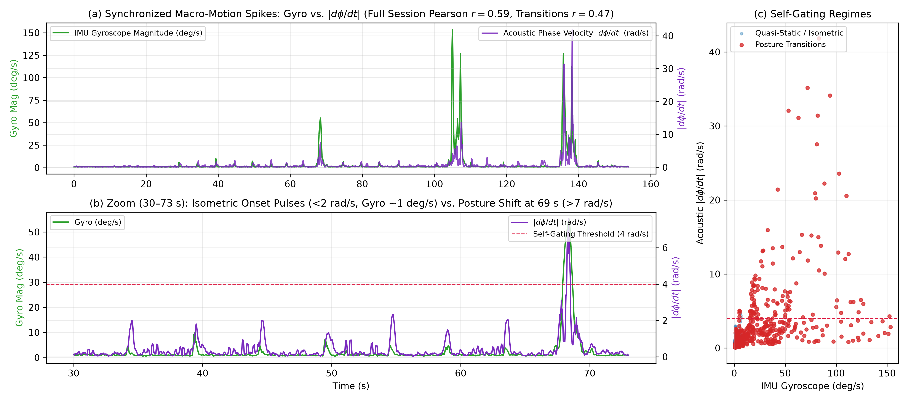

# Microresonance: Wireless 802.11 TSF-Coherent Active Acoustic Probing of the Skeletal Waveguide

[](https://doi.org/10.5281/zenodo.24533996)
[](https://patentscope.wipo.int/search/en/detail.jsf?docId=WO2026229867)
[](paper/microresonance_preprint_draft.pdf)
[](microresonance_receiver/)
[](scripts/)
[](physio_raw_20260514_175320.jsonl)

**Microresonance** is an experimental non-invasive neuromuscular interface (`< $100` commodity BOM) that extracts voluntary motor intent and limb posture by probing the **skeletal waveguide (cortical bone) shunt-loaded by tunable viscoelastic muscle-tendon resonators** rather than measuring passive electrical potentials (sEMG).

By injecting a phase-continuous **500 Hz mechanical carrier** at the lumbar waist belt and performing coherent **quadrature (I/Q) lock-in demodulation** at a distal ankle strap (`~0.9 m` skeletal path) synchronized via hardware 802.11 Wi-Fi **TSF (Timing Synchronization Function)** clocks (`< 2 µs` jitter), the system achieves a resting phase noise floor of **`3.01°`** (`99.9%` lock stability, `30 ms` frame latency) while operating dry, through clothing, and remaining resilient to orthostatic postural load that saturates conventional surface EMG (`20.7×` baseline floor surge).

- **Full 4-Page IEEE Preprint:** [`paper/microresonance_preprint_draft.pdf`](paper/microresonance_preprint_draft.pdf) ([LaTeX source](paper/microresonance_preprint_draft.tex))
- **Zenodo Archival Release (DOI):** [10.5281/zenodo.24533996](https://doi.org/10.5281/zenodo.24533996)
- **International Patent Publication:** [WO/2026/229867 (PCT/IB2026/054169)](https://patentscope.wipo.int/search/en/detail.jsf?docId=WO2026229867) (priority Apr–May 2025, published Nov 5, 2026)

---

## 1. Motivation: Why Active Acoustic Probing?

| Modality | Physical Observable | Skin / Coupling Requirement | Orthostatic / Postural Load Resilience | Hardware Complexity |
| :--- | :--- | :--- | :--- | :--- |
| **Passive sEMG** | Motor unit action potentials ($\mu\text{V}$ electrical noise) | Bare skin, conductive gel/dry electrodes, low impedance | **Poor** — standing postural recruitment floods the baseline ($>20\times$ noise floor surge) | Low–Medium |
| **Passive MMG / Accelerometry** | Low-frequency lateral fiber oscillation ($5\text{–}40\text{ Hz}$) | Dry strap | **Poor** — heavily corrupted by limb motion and gravity vector shifts | Low |
| **Ultrasound SMG** | MHz acoustic echogenicity / B-mode cross-section | Acoustic gel, rigid transducer alignment | **High** — measures mechanical deformation directly | High (piezo array, high-voltage pulser, FPGA/DSP) |
| **Microresonance (This Work)** | **Coherent phase velocity & damping of a 500 Hz carrier** | **Dry strap / works through clothing** | **High** — orthogonal to electrical recruitment noise and low-frequency motion ($<50\text{ Hz}$) | **Low** (ESP32-S3, MEMS ADXL355, I2S DAC exciter) |

### Physical Principle: Skeletal Waveguide with Muscle-Impedance Loading

At $500\text{ Hz}$, shear waves in soft skeletal muscle attenuate within centimeters, whereas cortical bone conducts mechanical waves across the entire limb (`~0.9 m`, waist belt to distal ankle / lateral malleolus) with low loss. We model the limb as a **skeletal waveguide (bone) shunt-loaded by tunable viscoelastic resonators (muscles and tendons)** — building on the biomechanical *"muscle tuning"* paradigm (Nigg & Wakeling, 2001) and analogous to damping a guitar string:
- Letting $Z_0 > 0$ denote the bone waveguide characteristic impedance and $Z_m(\omega; G, \eta) = R_m(\eta) + j(\omega m_{\text{eff}} - k(G)/\omega)$ the coupled muscle–tendon load impedance, the loaded transfer function and contraction phase shift follow:
  $$H(\omega) = \frac{H_0(\omega)}{1 + \alpha\, Z_m(\omega; G, \eta)/Z_0}, \qquad \Delta\phi = \arg\!\frac{H_{\text{contracted}}(\omega)}{H_{\text{relaxed}}(\omega)}$$
- Above the tens-of-Hz soft-tissue resonance ($\omega > \omega_0$), increasing muscle stiffness $k(G)\uparrow$ produces a bounded **phase lead ($\Delta(\arg H) = +36^\circ\text{ to }+67^\circ$)** paired with a **`+11–16%` transmission gain ($|H|\uparrow$)**.
- Simultaneously, hip/knee joint angles alter boundary coupling between bone segments, producing sharp **3D wave polarization shifts ($\Delta\phi_{XY}, \Delta\phi_{YZ}$)** that classify limb posture (`100%` holdout accuracy, $N=1$, zero IMU) orthogonally to voluntary isometric effort.
- Because the receiver mixes the $4000\text{ Hz}$ accelerometer stream coherently at $f_0 = 500\text{ Hz}$ against a TSF-synchronized local oscillator, low-frequency motion ($<50\text{ Hz}$) and stochastic sEMG firing fall outside the narrow lock-in passband.

---

## 2. Experimental Validation: Session `175320`

All raw multi-modal telemetry from the reference session is committed directly in this repository:
- **Raw dataset:** [`physio_raw_20260514_175320.jsonl`](physio_raw_20260514_175320.jsonl) (`5,136` frames, `153.74 s` duration, `33.4 Hz` frame rate, `500.0 Hz` carrier).
- **Reproducible analysis script:** [`scripts/analyze_session.py`](scripts/analyze_session.py)

### Preprint Figures (`paper/figures/`, 300 DPI)

All four publication figures are reproducible directly from `physio_raw_20260514_175320.jsonl` via [`scripts/generate_paper_figures.py`](scripts/generate_paper_figures.py):

#### 1. Six-State Phase–Magnitude Attractors & Acoustic Phase vs. sEMG

*Six discrete biomechanical states (3 postures × relaxed/contracted) separate cleanly in 4D acoustic space (`92.8%` holdout accuracy, Silhouette `+0.46` vs. `-0.24` for sEMG); under standing orthostatic load, sEMG baseline rises `20.7×` while acoustic phase preserves a `66.1°` step (`d = 3.57`).*

#### 2. Non-Circular Protocol-Frequency (`0.10 Hz`) SNR Spectra

*Independent frequency-domain SNR at the known `0.10 Hz` contraction cadence (`~5 s` hold / `~5 s` rest): Acoustic Phase achieves `33.0 / 31.3 / 28.2 dB` across seated, extended, and standing regimes — outperforming co-located sEMG by `+18.1 to +26.7 dB` and IMU tilt by `+9.8 to +12.4 dB`.*

#### 3. 3D Wave Polarization Orthogonality (IMU-Free Posture Classification)

*Inter-axis phase differences `Δφ_XY` and `Δφ_YZ` depend on joint/waveguide geometry rather than isometric effort, achieving `100.0%` IMU-free 3-posture classification (`N = 1`) orthogonally to voluntary contraction.*

#### 4. Motion Dynamics vs. Acoustic Phase Velocity (Self-Gating)

*Co-located gyroscope magnitude correlates with acoustic phase velocity `|dφ/dt|` (`r = 0.59`), with `17.9×` peak separation between macroscopic posture transitions (`41.8 rad/s`) and isometric holds (`2.34 rad/s`), enabling self-gating at `4 rad/s` without an IMU.*

### Full 7-Panel Session Overview (`scripts/analyze_session.py`)


### Chronological Regime Breakdown

| Time Window | Experimental Protocol | Acoustic Phase Behavior (500 Hz Lock-In) | Reference sEMG Behavior (Neural ADC) |
| :--- | :--- | :--- | :--- |
| **`0 – 30 s`** | **Static Rest (Seated)** | **Acoustic Hard-Lock.** Unwrapped phase holds flat at $\sim 5.3\text{ rad}$; inter-axis differential phase $\Delta\phi_{XY}$ is locked within $\pm 1.5^\circ$. | Low resting baseline floor ($25\text{th pct} \approx 9.8$), sporadic micro-spikes. |
| **`30 – 68 s`** | **Seated Isometric Intent Cycles** (~5 s tension / relaxation) | **Clean Step Response.** Voluntary isometric contractions produce repeatable, square-like phase steps (**$\sim 36^\circ\text{–}67^\circ$**) and concurrent `+11–16%` carrier magnitude rises above $\omega_0$. | Bursts correlate with contractions, though noisy within each hold. |
| **`68 – 105 s`** | **Posture Change (Seated Leg Extension)** | **Waveguide Re-Lock.** At `68 s`, extending the leg alters waveguide geometry; $\Delta\phi_{XY}$ flips by $+180^\circ$ to a new stable plateau and immediately resumes tracking isometric intent steps. | Baseline shifts; spike amplitude becomes less uniform. |
| **`107 – 136 s`** | **Standing Up (Orthostatic Postural Load)** | **Preserved Intent Contrast.** Despite full body-weight load on the leg, conscious isometric contractions continue to produce distinct, flat-topped phase steps (**Zoom Panel 6**). | **Signal Collapse.** Static postural recruitment raises the sEMG baseline floor **20.7×** (`9.8` $\to$ `203.1`), masking voluntary clicks in continuous background tetanus. |
| **`138 – 153.7 s`** | **Seated Recalibration** | Returning to the seated posture restores $\Delta\phi_{XY}$ and unwrapped phase to the initial baseline cluster. | Postural tetanus subsides back to resting floor. |

### Panel-by-Panel Guide to the Figure

1. **Full Session: Neural Intent vs. Acoustic Phase:** Overlays unwrapped 500 Hz acoustic phase (black, radians) against raw sEMG envelope standard deviation (red). Note the clean rectangular steps in acoustic phase throughout both seated (`30–105 s`) and standing (`110–136 s`) regimes.
2. **Acoustic Transmission (Magnitude):** Lock-in carrier amplitude at 500 Hz in gravitational units ($g$). Above soft-tissue resonance ($\omega > \omega_0$), isometric stiffening increases transmission gain by `+11–16%`, while passive strap/respiration drift (`CV = 15.6%`) remains largely decoupled from resting phase (`Corr(Mag, Phase) = +0.075`).
3. **Motion Dynamics (Gyroscope):** 3-axis angular velocity magnitude ($\text{deg/s}$) from the co-located LSM6DSOX IMU. Confirms that phase steps during `30–68 s`, `72–104 s`, and `110–135 s` occur under quasi-static isometric conditions ($\sim 1^\circ/\text{s}$), while sharp gyroscope spikes (`69 s`, `106 s`, `137 s`) mark macroscopic posture transitions.
4. **Inter-Axis Phase Coherency (XYZ Vector Stability):** Differential lock-in phase between accelerometer axes ($\Delta\phi_{XY} = \phi_X - \phi_Y$, $\Delta\phi_{YZ} = \phi_Y - \phi_Z$). Cancels common-mode sensor translation and acts as an instantaneous geometric posture signature.
5. **Acoustic Reaction Speed (Phase Velocity):** Time derivative $|\text{d}\phi/\text{d}t|$ ($\text{rad/s}$), highlighting rapid mechanical state transitions at contraction onset/release.
6. **ZOOM: Standing & Final Sitting (`100 s – End`):** High-resolution view of the standing orthostatic stress test. Between `110 s` and `135 s`, sEMG saturates into continuous postural noise while the acoustic phase trace resolves three discrete voluntary isometric holds (`114–120 s`, `123–130 s`, `130–135 s`).
7. **The Universal Bio-Acoustic Alphabet (Phase vs. Mag Space):** Joint phase–magnitude state-space projection colored by sEMG intensity, revealing discrete, separable attractors corresponding to biomechanical states (relaxed seated, contracted seated, extended, standing loaded).

---

## 3. Hardware & Embedded System Architecture

The hardware consists of two wireless **ESP32-S3** nodes synchronized over standard 2.4 GHz Wi-Fi without any interconnecting cable between emitter and detector.

| Active Acoustic Emitter Belt (`microresonance_transceiver`) | Coherent Multi-Modal Receiver Strap (`microresonance_receiver`) |
| :---: | :---: |
|  |  |

### Key Firmware Engineering Solutions

Achieving sub-degree acoustic phase lock across independent wireless microcontrollers required solving three hardware-level bottlenecks in the firmware:

#### 1. Zero-Drift Wireless Coherency via 802.11 TSF Absolute-Phase NCO
Free-running crystal oscillators on separate MCUs drift by $10\text{–}20\text{ ppm}$ ($1800^\circ/\text{s}$ phase walk at $500\text{ Hz}$), destroying lock-in coherence within milliseconds.
- **Emitter ([`microresonance_transceiver/src/main.cpp`](microresonance_transceiver/src/main.cpp)):** Queries the hardware 802.11 Wi-Fi Beacon **Timing Synchronization Function (`esp_wifi_get_tsf_time`)** before each I2S DMA buffer and computes the exact analytical carrier phase for every sample $i$ at $44.1\text{ kHz}$:
  $$\phi_i = 2\pi \cdot \left( \left( t_{\text{TSF}} \cdot 10^{-6} + \frac{i}{f_s} \right) f_{\text{carrier}} \bmod 1.0 \right)$$
- Driven through a 4-wire **PCM5102A I2S DAC** using the ESP32-S3 **APLL** (`use_apll = true`) and external Master Clock (`MCLK` on `GPIO 15`).
- **Receiver ([`microresonance_receiver/src/dsp_task.cpp`](microresonance_receiver/src/dsp_task.cpp)):** Captures the rising edge of the **ADXL355** hardware `DRDY` pin (`GPIO 13`) in an IRAM ISR (`drdy_isr`), measures the exact ISR-to-SPI readout lag `drdyAgeUs`, and back-dates the Wi-Fi TSF timestamp (`tsf = tsfAfter - drdyAgeUs`).

#### 2. Asymmetric Dual-Core FreeRTOS Isolation (Eliminating 3.3V ADC Rail Cross-Talk)
At $20\text{-bit}$ resolution ($\sim 3.9\,\mu g/\text{LSB}$), the **ADXL355** accelerometer is sensitive enough that calling `analogRead()` on the ESP32-S3 SAR ADC for sEMG measurement induces transient current spikes on the shared $3.3\text{ V}$ supply rail, appearing as synthetic vibration noise.
- **Core 1 (`sensorTask` @ Prio 5, `dspTask` @ Prio 4):** Dedicated exclusively to deterministic $4000\text{ Hz}$ SPI bursts from the ADXL355 and non-blocking UDP dispatch. Zero ADC reads or I2C stalls occur on Core 1.
- **Core 0 (`lsmTask` @ Prio 3):** Polls the **LSM6DSOX** 6-axis IMU (`400 kHz` I2C + hardware 24-bit timestamp registers) and samples the analog **sEMG** channel (`GPIO 1`) into a lock-free ring buffer indexed by `g_active_ab`.

#### 3. MTU-Safe UDP Streaming with WMM `AC_VO` Voice QoS
Standard Wi-Fi MAC layers buffer outbound packets into A-MPDU aggregates (up to 16 frames), introducing $15\text{–}60\text{ ms}$ burst jitter.
- **Wire Protocol ([`microresonance_receiver/include/dsp_packet.h`](microresonance_receiver/include/dsp_packet.h)):** Packs $120\times 3\text{-axis}$ ADXL355 samples ($30\text{ ms}$ window), $30\times 6\text{-axis}$ LSM6DSOX IMU samples + timestamps, and $120$ sEMG samples into a packed **1460-byte `RawSyncPacket` (`0x4D58`)** — fitting inside a single IPv4 UDP datagram (`< 1472` bytes) with zero IP fragmentation.
- Tags the UDP socket with `IP_TOS = 0xE0` (**WMM `AC_VO` Voice priority**), instructing the Wi-Fi baseband to disable A-MPDU aggregation and transmit each $30\text{ ms}$ window immediately.

---

## 4. Repository Structure & Quick Start

```text
microresonance/
├── microresonance_transceiver/       # ESP32-S3 Active Acoustic Emitter Firmware (PlatformIO)
│   ├── include/                      # Pinout config, TSF clock helper, AD9833 & UI state headers
│   ├── src/                          # TSF-locked NCO audio engine (I2S PCM5102A), OLED UI, HTTP sync
│   └── platformio.ini                # Build config for ESP32-S3-CAM (N16R8)
├── microresonance_receiver/          # ESP32-S3 Coherent Multi-Modal Receiver Firmware (PlatformIO)
│   ├── include/                      # RawSyncPacket (0x4D58) wire format, DSP task & ADS8681 headers
│   ├── src/                          # Dual-core ADXL355 SPI + LSM6DSOX I2C + sEMG capture & UDP streamer
│   └── platformio.ini                # Build config for ESP32-S3 (FH4R2)
├── paper/                            # 4-Page IEEE Preprint (LaTeX, 300-DPI Figures, PDF & Build Script)
│   ├── microresonance_preprint_draft.pdf  # Compiled 4-page IEEE preprint
│   ├── microresonance_preprint_draft.tex  # Full LaTeX source
│   ├── build_pdf.sh                  # Reproducible single-command PDF build script (Tectonic)
│   └── figures/                      # Publication figures (300 DPI)
├── scripts/                          # Python Signal Interpretation, Verification & Figure Suite
│   ├── analyze_session.py            # Reproduces the 7-panel plot & regime metrics from raw JSONL
│   ├── verify_paper_claims.py        # Independent 28/28 numerical audit of all paper claims vs. raw JSONL
│   ├── generate_paper_figures.py     # Reproduces all 4 publication-grade 300-DPI figures
│   └── lockin_dsp_reference.py       # Reference RawSyncPacket parser & TSF-coherent I/Q demodulator
├── physio_raw_20260514_175320.jsonl  # Raw multi-modal experimental dataset (5,136 frames, 153.7s)
├── 1778779569118.png                 # Generated 7-panel visualization from Session 175320
├── IMG20260514213337.jpg             # Hardware photo: Emitter belt assembly
├── IMG20260514213901.jpg             # Hardware photo: Receiver / detector strap
└── requirements.txt                  # Python dependencies (numpy, matplotlib)
```

### Reproduce the Session Analysis & Plots

```bash
# 1. Create a virtual environment and install dependencies
python3 -m venv .venv
source .venv/bin/activate
pip install -r requirements.txt

# 2. Run the session analyzer on the raw JSONL dump (prints regime report & generates PNG)
python3 scripts/analyze_session.py \
    --input physio_raw_20260514_175320.jsonl \
    --output 1778779569118.png

# 3. Run the independent 28/28 numerical verification audit of all preprint claims
python3 scripts/verify_paper_claims.py

# 4. Regenerate all 4 publication-grade 300-DPI figures (paper/figures/)
python3 scripts/generate_paper_figures.py

# 5. Run the mathematical self-test of the TSF-coherent I/Q lock-in demodulator
python3 scripts/lockin_dsp_reference.py --self-test

# 6. Rebuild the 4-page IEEE preprint PDF from LaTeX source (uses Tectonic)
./paper/build_pdf.sh
```

### Sample Console Output (`scripts/analyze_session.py`)

```text
========================================================================================
MICRORESONANCE TELEMETRY REPORT — physio_raw_20260514_175320.jsonl
========================================================================================
Frames: 5136  |  Duration: 153.74 s  |  Frame interval: 29.93 ms  |  Carrier: 500.0 Hz  |  Hard-Lock: 99.9%
----------------------------------------------------------------------------------------
Experimental Regime                | Window (s)   | Phase Range (rad) | Mean Mag (mg) | sEMG RMS/Std
----------------------------------------------------------------------------------------
1. Static Rest (Acoustic Lock)     |   0.0–30.0   |             0.353 |         2.657 |         91.4
2. Seated Isometric Cycles         |  30.0–68.0   |             1.093 |         3.293 |         84.0
3. Seated Leg Extension (Re-Lock)  |  70.0–105.0  |             0.964 |         2.575 |         36.7
4. Standing Orthostatic Load       | 110.0–136.0  |             1.910 |         2.324 |        260.8
5. Seated Recalibration            | 140.0–153.7  |             0.798 |         2.106 |         50.6
----------------------------------------------------------------------------------------
Key Comparative Findings (Seated vs. Standing Orthostatic Load):
  * sEMG Baseline Floor (25th pct):   9.8 (seated) -> 203.1 (standing) [20.7x postural noise surge]
  * Acoustic Phase Dynamic Step:      57.8 deg (seated) vs. 103.8 deg (standing) [step contrast preserved]
  * Peak Postural Transition Gyro:    159.0 deg/s (settled to 1.03 deg/s during standing holds)
========================================================================================
```

---

## 5. Current Scope, Limitations & Roadmap

- **Current Validation Scope:** The dataset included here represents an $N=1$ proof-of-principle demonstrating coherent phase hard-lock and orthostatic noise immunity under controlled seated-to-standing transitions.
- **Waveguide Geometry Calibration:** Macroscopic changes in joint angle alter the physical path length between exciter and receiver, shifting the absolute baseline phase to a new attractor (as seen at `68 s` and `138 s`). While inter-axis differential phase ($\Delta\phi_{XY}, \Delta\phi_{YZ}$) and IMU fusion cleanly segment these posture transitions, automated baseline re-zeroing across continuous dynamic motion is an active focus.
- **Next Engineering Milestones:**
  1. **Dual-Frequency MIMO Differential Probing (`f1` / `f2`):** Using beat-phase dispersion ($\Delta\phi_{\text{beat}}$) between two simultaneous carriers (e.g., `311 Hz` and `500 Hz`) to cancel geometric path-length changes without relying on IMU gating.
  2. **Multi-Subject & Multi-DoF Gesture Alphabet:** Expanding state-space clustering in $(\phi, \text{Mag}, \Delta\phi_{XY})$ space to classify fine finger and wrist isometric intents through clothing.
  3. **Single-Strap Wearable Integration:** Miniaturizing the exciter and ADXL355 detector into a unified dry elastomer band for exoskeleton, prosthetics, and AR/VR human-computer interaction.

---

## Citation

If you use this hardware architecture, dataset, or analysis scripts in your research, please cite:

```bibtex
@misc{fatkulin2026microresonance,
  author       = {Amir Fatkulin},
  title        = {Microresonance: Wireless 802.11 TSF-Coherent Active Acoustic Probing of the Skeletal Waveguide for Real-Time Isometric Motor Intent and Posture Decoupling},
  year         = {2026},
  publisher    = {Zenodo},
  doi          = {10.5281/zenodo.24533996},
  url          = {https://doi.org/10.5281/zenodo.24533996}
}
```

## Recommended GitHub Repository Topics / Tags

`non-invasive-bci` `human-computer-interaction` `biomedical-signal-processing` `acoustic-impedance` `sonomyography` `semg` `lock-in-amplifier` `esp32-s3` `adxl355` `neurotech` `wearable-sensors` `biomechanics` `embedded-dsp`
